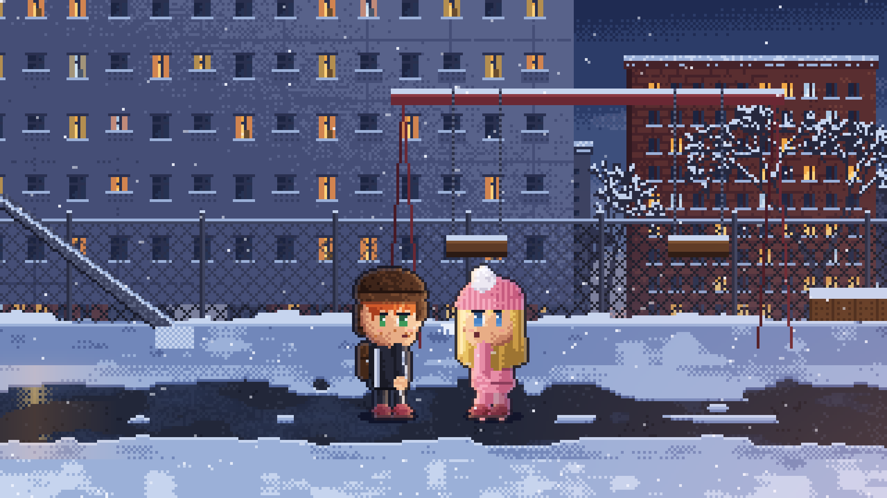
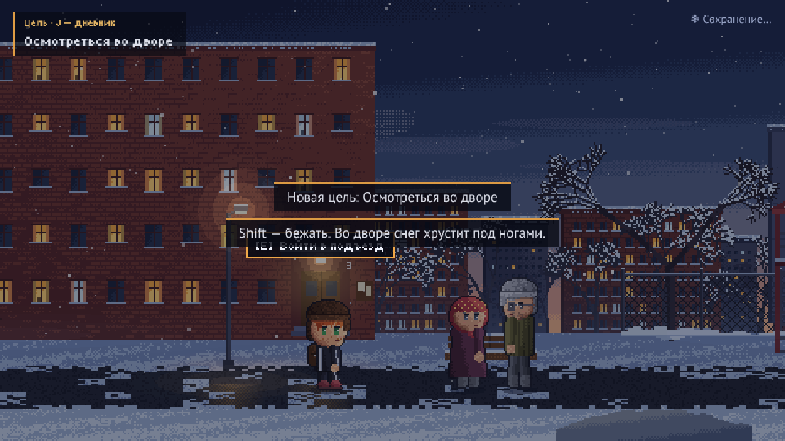
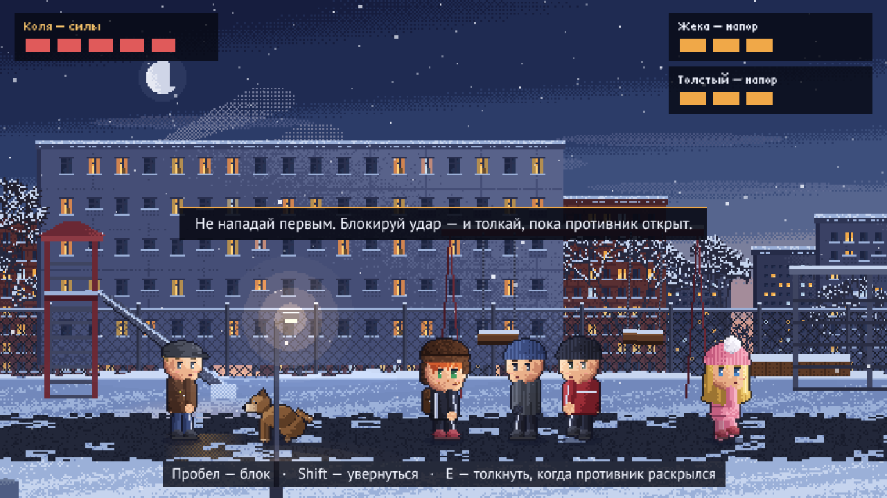
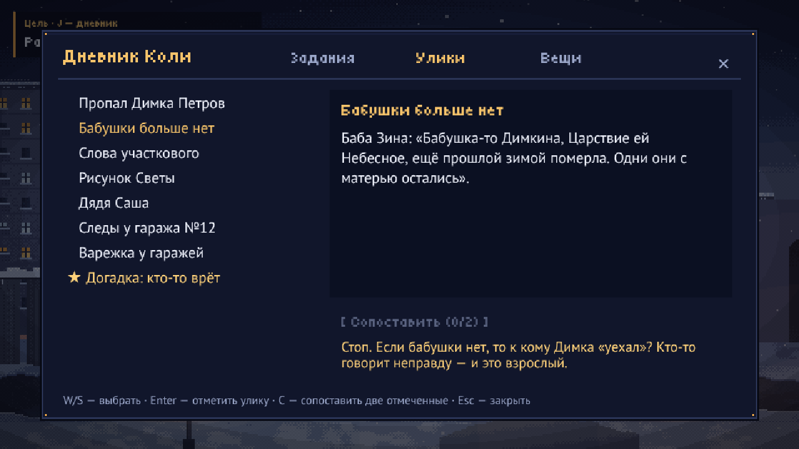
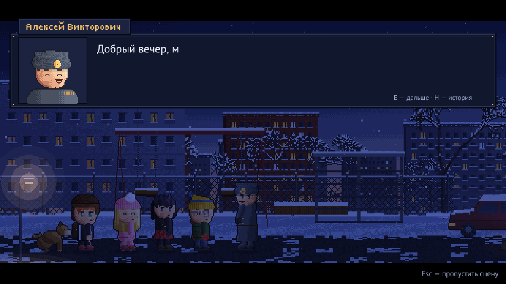

# Коля: Маленький хулиган

Сюжетное пиксельное приключение о зиме, девяностых и новом дворе.
Это первая глава, «Новый двор», и её можно пройти от начала до конца.



Тринадцатилетний Коля две недели назад переехал с родителями в провинциальный город. Дома родители ругаются, во дворе живут свои порядки, а мальчишка из соседнего дома третий день не появляется. Взрослые говорят, что он «уехал к бабушке».

Что есть в главе:

- квартира и большой двор с детской площадкой, гаражами и аркой;
- 13 персонажей с анимациями и портретами;
- диалоги с выборами, которые учитываются в итогах главы;
- спасение пса, короткая стычка с хулиганами (блок, уворот, толчок);
- расследование: улики, дневник, сопоставление улик;
- кат-сцены, сохранение и загрузка, настройки, переназначение клавиш;
- весь текст на русском языке.

| | |
|---|---|
|  |  |
|  |  |

## Как запустить

Нужен [Node.js](https://nodejs.org) версии 18 или новее.

```bash
npm install        # установить зависимости (один раз)
npm run dev        # запустить игру в режиме разработки → http://localhost:5173
```

### Готовая сборка

```bash
npm run build      # проверка типов + сборка в папку dist/
npm run preview    # раздать dist/ → http://localhost:4173
```

Папку `dist/` можно выложить на любой статический хостинг или раздать локально, например командой `npx serve dist`.
Открыть `dist/index.html` двойным щелчком не получится: браузер не загружает модули и звук с `file://`, поэтому нужен веб-сервер.
Во время игры интернет не нужен.

### Проверки

```bash
npm run typecheck  # TypeScript
npm run lint       # ESLint
npm test           # модульные тесты (Vitest): сохранения, квесты, диалоги, целостность контента, русский текст
```

Сквозные тесты запускают настоящий Chromium (Playwright) и играют с клавиатуры, как человек:

```bash
npm run build && npm run preview &   # сервер на :4173
npm run test:e2e                     # полное прохождение главы 1 от «Новой игры» до финального экрана
npm run test:scenarios               # проигрыш и повтор драки, переходы дом ↔ двор, повреждённые сохранения,
                                     # переназначение клавиш, пропуск кат-сцен, разные размеры окна
```

Скриншоты прогонов сохраняются в `test-results/`. Отчёт о проверках лежит в [docs/QA_REPORT.md](docs/QA_REPORT.md).

## Управление

| Действие | Клавиши |
|---|---|
| Идти | A / D или стрелки |
| Бежать (во дворе) | Shift |
| Действие, говорить, толкнуть в драке | E или Enter |
| Блок в драке | Пробел |
| Уворот в драке | Shift |
| Дневник: задания, улики, вещи | J или Tab |
| История реплик | H |
| Пауза; пропустить кат-сцену | Esc |
| Выбор ответа | 1–3, стрелки + Enter или мышь |

Клавиши можно переназначить в меню «Управление».

## Как это сделано

- **Движок:** Phaser 3.90 + TypeScript + Vite. Без сервера и без платных API.
- **Разрешение:** мир нарисован в 480×270 пикселей и выводится с целочисленным увеличением ×2, ×3 или ×4 (выбирается по размеру экрана; можно задать вручную: `?zoom=2`). Интерфейс рисуется отдельно, поэтому кириллица остаётся чёткой.
- **Графика** создаётся программно: скрипты в `tools/art/` рисуют пиксельные кластеры с затенением, дизерингом и выборочным контуром и сохраняют PNG-листы спрайтов (`npm run assets`). Готовые файлы лежат в `public/assets/gen/`.
- **Музыка и звуки** оригинальные: их синтезирует `tools/audio.ts` и кодирует в OGG и MP3.
- **Шрифты:** PT Sans (основной текст) и Tiny5 (пиксельные заголовки), оба с полной кириллицей и буквой Ё. Лицензия SIL OFL, файлы шрифтов включены в сборку.

### Структура проекта

```
index.html                 страница игры
src/
  main.ts                  запуск: шрифты, конфигурация Phaser
  config.ts                разрешение, зум, цвета, шрифты
  services.ts              общий контейнер: настройки, ввод, звук, сохранения, сессия
  core/                    логика без Phaser (покрыта модульными тестами)
    types.ts               интерфейсы контента (диалоги, условия, эффекты)
    state.ts               состояние игры, условия, эффекты, улики
    session.ts             текущая сессия, автопереходы этапов квеста
    dialogue.ts            движок диалогов и валидатор графа
    save.ts                версионные сохранения в localStorage
    settings.ts            настройки и раскладка клавиш
  content/                 весь русский текст и данные
    dialogues.ts           все диалоги главы 1
    quests.ts              этапы главного квеста
    items.ts               предметы, улики, правила сопоставления
    characters.ts          имена, голоса
    levels.ts              уровни: объекты, NPC, точки взаимодействия, свет
    chapters.ts            план глав 2–4
    summary.ts             итоги главы по сделанным выборам
  systems/                 ввод (действия → клавиши), звук (музыка, эмбиент, эффекты)
  world/                   Actor (персонаж), Dog (пёс), Fight (драка)
  scenes/                  Boot, Title, World, UI, End
  ui/                      виджеты, меню, диалоговое окно, дневник
tools/
  art/                     генераторы пиксель-арта: персонажи, окружение, интерьер, предметы
  audio.ts                 синтезатор музыки и звуков
  generate-assets.ts       собирает все ассеты и manifest.json
  make-release.mjs         упаковывает ZIP-архивы
public/assets/gen/         сгенерированные PNG, звук, manifest.json
tests/unit/                модульные тесты (Vitest)
tests/e2e/                 сквозные тесты (Playwright)
docs/                      ключевой арт, скриншоты, отчёт QA, сюжет
```

## Как расширять игру

**Новый диалог.** Добавьте объект в `src/content/dialogues.ts`: узлы с `speaker`, `expr`, `text`, `next`, `choices`, `effects` и условиями `cond`. Тест `npm test` проверит, что нет висячих ссылок, недостижимых узлов и латиницы в тексте.

**Новый этап квеста.** Добавьте этап в `STAGES` (`src/content/quests.ts`), строго по порядку. Этапы двигаются только вперёд, через эффект `{ stage: 'id' }`.

**Новая улика или предмет.** Добавьте их в `ITEMS` или `CLUES` (`src/content/items.ts`). Сопоставления задаются в `COMBINE_RULES`, иконки предметов — в `tools/art/extra.ts`.

**Новый персонаж.**
1. Опишите внешность в `tools/art/cast.ts`: телосложение, причёска, шапка, одежда, цвета. При необходимости добавьте особые анимации в `extraAnims`.
2. Добавьте имя и голос в `src/content/characters.ts`.
3. Запустите `npm run assets`: появятся лист спрайтов и портреты с пятью эмоциями.

**Новая локация.**
1. Нарисуйте фон функцией в `tools/art/` (по образцу `drawCourtyard` или `drawApartment`) и зарегистрируйте её в `tools/generate-assets.ts`.
2. Опишите уровень в `src/content/levels.ts`: ширину, слои параллакса, объекты с якорями, NPC, точки взаимодействия, двери, триггеры и свет.
3. Добавьте id уровня в тип `LevelId` (`src/core/state.ts`).

## Лицензии и авторство

Сценарий, код, графика, музыка и звуки созданы для этого проекта. Сторонние компоненты: Phaser (MIT), шрифты PT Sans и Tiny5 (SIL OFL 1.1). Подробности — в [ASSETS.md](ASSETS.md).
